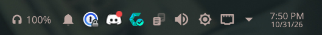
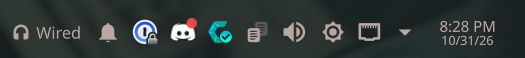
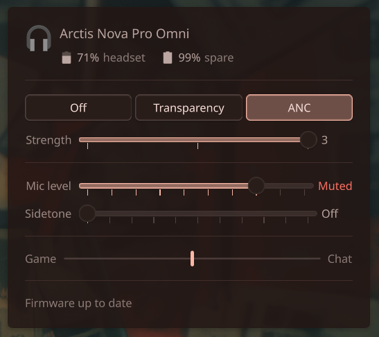

# arctis-omni-linux

Linux controls for SteelSeries Arctis Nova Pro headsets: noise cancelling /
transparency, mic sidetone, a working ChatMix dial, and a KDE Plasma panel widget with the
battery level and status.

## Supported devices

| | Arctis Nova Pro Omni | Arctis Nova Pro Wireless | Arctis Nova Pro (wired) |
|---|---|---|---|
| Connects through | GameHub | Base station (PC / Xbox / Xbox white) | GameDAC Gen 2 (PC / Xbox) |
| USB ID | `1038:2290` | `1038:12e0` / `12e5` / `225d` | `1038:12cb` / `12cd` |
| Headset and spare battery | ✅ | ✅ (12.5% steps) | — wired |
| Charging state | ✅ | ✅ | — wired |
| Noise mode: off / transparency / ANC | ✅ | ✅ | — no ANC |
| Transparency level (1-10) | ✅ | ✅ | — no ANC |
| ANC strength (1-3) | ✅ | — not adjustable | — no ANC |
| Mic sidetone | ✅ off / 1-10 | ✅ off / 1-3 | ✅ off / 1-3 |
| Mic volume and mute state | ✅ | ✅ | ✅ volume only |
| ChatMix dial → Game/Chat outputs | ✅ | ✅ | ✅ |
| Plasma widget | ✅ | ✅ | ✅ shows "Wired" |
| Tested on | `2290` | `12e5` | `12cb` |

SteelSeries GG is Windows-only. This talks to the base station / GameDAC directly over
`hidraw`, with no kernel module or GG install.

## Screenshots

The Plasma widget sits in the panel. Wireless headsets show their battery; wired ones show
"Wired":





Clicking it opens the controls (here on an Arctis Nova Pro Omni):



- **Noise mode**: Off / Transparency / ANC, with a strength slider for the active mode.
- **Mic level** and **sidetone**: "Muted" appears when the headset mic is muted.
- **ChatMix**: the marker follows the base station's dial between Game and Chat.
- **Firmware**: an **Update…** button appears when SteelSeries has newer firmware.

Rows a headset doesn't have are left out. A wired Nova Pro, for example, shows no batteries
or noise mode.

## What you get

- **`arctis-omni`**: a small Python CLI.
  ```
  arctis-omni status [--json]           # battery, spare battery, noise mode, sidetone, mic, dial
  arctis-omni anc off|transparency|anc  # wireless models
  arctis-omni anc-level 1-3              # Omni only
  arctis-omni transparency-level 1-10    # wireless models
  arctis-omni sidetone on|off|<level>   # Omni 1-10, Nova Pro Wireless / wired 1-3
  arctis-omni mic-volume 1-10
  arctis-omni output [headset|<sink>]   # where Arctis Game/Chat play (see below)
  arctis-omni firmware check|update     # firmware updates (see below)
  ```
- **ChatMix**: a user service plus PipeWire config that adds two outputs, **Arctis Game**
  and **Arctis Chat**. The service routes both to whichever supported headset is
  connected, and the dial sets their volumes.
- **Plasma 6 widget** ("Arctis Headset Battery"): headset battery in the panel, and a popup
  with the noise mode and its strength, mic level, sidetone, ChatMix and firmware status.
- **udev rule** so your user can open the base station's `hidraw` node without root.

## Install

Requirements: Python 3, PipeWire with `pipewire-pulse` (`pactl`) and WirePlumber, systemd
user services, and Plasma 6 for the widget.

### Arch Linux and derivatives (CachyOS, EndeavourOS, Manjaro…)

Each [release](https://github.com/LDCanetti/arctis-omni-linux/releases/latest) has a ready-made
package. Install it with pacman, using the `.pkg.tar.zst` link from the release:

```sh
sudo pacman -U https://github.com/LDCanetti/arctis-omni-linux/releases/download/v0.3.0/arctis-omni-linux-0.3.0-1-any.pkg.tar.zst
```

Or build it yourself from the PKGBUILD:

```sh
git clone https://github.com/LDCanetti/arctis-omni-linux
cd arctis-omni-linux/packaging/arch
makepkg -si
```

Then, as your normal user:

```sh
systemctl --user enable --now arctis-omni-chatmix.service
systemctl --user restart pipewire   # loads the Arctis Game / Arctis Chat outputs
```

Replug the base station so the udev rule applies. Restarting PipeWire drops running apps'
audio streams; Discord needs you to rejoin voice.

### Any distribution (per-user install)

```sh
git clone https://github.com/LDCanetti/arctis-omni-linux
cd arctis-omni-linux
./install.sh                 # uses sudo for the udev rule
SUDO=pkexec ./install.sh     # or a graphical password prompt
```

This installs to your home directory, plus the udev rule. It refuses if the pacman package
is installed, since both together would load the Game/Chat outputs twice. `./uninstall.sh`
removes it and puts the hub back into hardware ChatMix mode.

The CLI goes to `~/.local/bin`. If your shell doesn't already have that on `PATH` (stock
Arch bash doesn't), `install.sh` says so; add `export PATH="$HOME/.local/bin:$PATH"` to
`~/.bashrc` or `~/.zshrc`. The service and widget don't need it.

### After installing

1. Set your default output to **Arctis Game** and your voice app's output (Discord etc.)
   to **Arctis Chat**. Apps that play to the headset's own output aren't
   affected by the dial.
2. Add **Arctis Headset Battery** to a panel (right-click the panel → Add Widgets).

## How ChatMix works

These base stations don't mix game and chat audio themselves for a single PC. Their
hardware mix only blends their two USB inputs (PC on USB-1 vs. an Xbox). On Windows, GG
switches the hub into **software ChatMix** mode, and the Sonar app does the mixing on the
PC. This project does the same: `arctis-omni chatmix-daemon` tells the hub that Sonar is
present and enables software mode, points
the Game/Chat outputs at the connected headset (via PipeWire's `target.object` routing
metadata), listens for dial events, and sets the two outputs' volumes with `pactl`. When the
service stops, it clears both, as GG does when it shuts down. The wired Nova Pro's GameDAC
only lets its knob switch to ChatMix while "Sonar present" is set (it shows a Sonar icon).

The loopback sinks use `node.dont-fallback` + `node.linger`. If the headset disappears, they
wait for it instead of moving your game audio to the speakers.

### Playing Game and Chat somewhere else

To switch to speakers without losing chat, move both outputs instead of changing your
default output:

```sh
arctis-omni output alsa_output.pci-0000_11_00.6.analog-stereo   # a sink name from 'pactl list short sinks'
arctis-omni output headset                                       # back to the headset
arctis-omni output                                               # show the current choice
```

Apps stay on Arctis Game / Arctis Chat, and the ChatMix dial keeps balancing them. The choice
is saved in `~/.local/state/arctis-omni/output`, and the service keeps it across restarts.
If that output disappears, it falls back to the headset. Bind the two commands to a hotkey
to toggle.

Apps that hold an audio stream open all the time (Discord does while it runs) keep whatever
output Arctis Chat plays to awake, the same as if they played to it directly.

## Protocol

All models use 64-byte HID output reports on the **usage page `0xFFC0`** collection, with
**report ID `0x01`** (Omni) or **`0x06`** (Nova Pro Wireless and wired), shown as `rid`
below. They send events as **report ID `0x07`** on the same interface, interleaved with
command replies, so filter on both bytes. The wired Nova Pro has no `B0` status (no battery,
link or noise mode); its settings block and sidetone match the Nova Pro Wireless.

| Function | Command | Notes |
|---|---|---|
| Status | `rid B0` → `rid B0 …` | `[6]` headset battery, `[7]` spare battery (Omni: %, Nova Pro Wireless: 0-8 in 12.5% steps), `[8]` transparency level, `[9]` mic mute, `[10]` noise mode, `[14]` link state (`0x08` = connected), `[15]` charging state (`2` charging, `4` full, `8` on battery), `[16]` ANC level (Omni only) |
| Noise mode | `rid BD <mode>` | `0` off, `1` transparency, `2` ANC |
| ANC level | `01 B8 <1-3>` | Omni only |
| Transparency level | `rid B9 <1-10>` | |
| Mic sidetone | Omni `01 38 <on 0/1> <level 1-10>`; Nova Pro Wireless `06 39 <0-3>` | Nova Pro Wireless: 0 off, 1 low, 2 medium, 3 high |
| Software ChatMix | `rid 49 <0/1>` | `1`: hub reports the dial instead of mixing |
| Sonar present | `rid 8D <0/1>` | Tells the hub a PC mixer is running; required for ChatMix on the wired GameDAC |
| Settings block | Omni: `01 20`, then a `HIDIOCGFEATURE` read of report 1 (1037 bytes) | Starts at the command byte. From offset 141: `+4` mic volume, `+5` sidetone level, `+10`/`+11` ChatMix game/chat, `+28` sidetone on/off |
| | Nova Pro Wireless and wired: `06 20` → `06 20 …` (normal reply) | `[17]` mic volume, `[18]` sidetone, `[20]`/`[21]` ChatMix game/chat |

| Event | Meaning |
|---|---|
| `07 45 <game> <chat>` | ChatMix dial. Each channel's volume is 0-100; the centre is 100/100, and turning towards one side fades the other channel to 0 |
| `07 B7 <headset> <spare> <charging>` | Battery change |

The command set was derived from SteelSeries GG's device definitions, for interoperability,
and then checked against the hardware. One exception: GG only *reads* the noise mode on the
Nova Pro Wireless. The `BD` and `B9` writes were found to work on it by testing, not from GG.

**Verified on hardware:**
- Omni, base firmware 1.32.0 / DSP 0.36.0, headset 0.36.0 (and earlier 1.28.0 / 0.33.0):
  status/battery fields, noise mode switching, ANC strength and transparency level (1.32.0),
  sidetone set and read back, ChatMix enable plus dial events, including after a replug.
- Nova Pro Wireless (`12e5`): status/battery fields, noise mode (off / transparency / ANC,
  confirmed audibly), transparency level, sidetone set and read back, ChatMix routing and
  dial events.
- Nova Pro wired (`12cb`, GameDAC firmware DSP 2.04.00 / MCU 1.10.08 / USB 0.28.00):
  sidetone set and read back, Sonar present, ChatMix routing and dial events.

**Not yet verified:** the charging value of `[15]` while actually charging.

## Firmware updates

SteelSeries publishes headset firmware only inside SteelSeries GG releases. A daily timer
(`arctis-omni-firmware-check.timer`) asks SteelSeries' update server (the one GG itself
uses) which GG version is current. When a new one appears, it downloads that installer once
(about 400 MB), checks it against the server's checksum, keeps only
the firmware for supported headsets in `~/.cache/arctis-omni` (about 20 MB), and compares it
with what the connected headset reports. If anything is newer, you get a desktop
notification, and the widget shows **Update available** with an **Update…** button.

```sh
arctis-omni firmware check    # check now
arctis-omni firmware update   # the interactive updater (the widget's button opens it in a terminal)
```

| Model | Update from Linux |
|---|---|
| Arctis Nova Pro (wired, PC GameDAC `12cb`) | ✅ USB, DSP and MCU chips, the same way GG does it. Verified by re-flashing all three. Updating the MCU resets the GameDAC's settings to their defaults. |
| Arctis Nova Pro (wired, Xbox GameDAC `12cd`) | Check only. Same method, but untested; update with GG. |
| Arctis Nova Pro Omni | Check only; update with GG on Windows. GG's updater only starts with **both the GameHub and the headset connected to the PC by USB cable**. |
| Arctis Nova Pro Wireless (Xbox base station `12e5`) | ✅ Base station DSP and MCU, headset MCU and Bluetooth, the same way GG does it. The headset's chips are written over **the headset's own USB cable**; the updater asks you to plug it in (or to skip the headset). Verified by re-flashing the base DSP and MCU and the headset Bluetooth chip of a v2 headset. The headset MCU path is GG's (shared with the base MCU) but hasn't been run. |
| Arctis Nova Pro Wireless (PC `12e0`, Xbox white `225d`) | Check only. Same method, but untested; update with GG. |

For models that are check-only, the Update button explains how to update with GG instead of
flashing. While the updater writes firmware, it:
- pauses the ChatMix service and holds a lock, so the widget and other commands leave the
  device alone;
- ignores Ctrl+C, and keeps going if its terminal is closed. SIGTERM aborts cleanly;
- refuses to start with more than one GameDAC or Nova Pro Wireless base station connected;
- reinstalls only what's already on the version GG ships, so it never downgrades a part.

If a GameDAC update is interrupted anyway, the GameDAC may not show up until it's replugged.
It then comes back as **SteelSeries Bootloader** (`1038:12cc`), and running
`arctis-omni firmware update` again offers to recover it. Recovery was tested by killing an
update halfway through the USB chip.

A Nova Pro Wireless base station or headset whose MCU update is interrupted should stay in
its bootloader (**SteelSeries Bootloader**, e.g. `1038:12e7` for the Xbox base station); the
updater then offers to recover it the same way. That hasn't been tested by interrupting one.
A bootloader with intact firmware behind it goes back to that firmware by itself after 5 s
(verified). The Bluetooth chip uses Qualcomm's upgrade process, which writes the new image
next to the running one and switches only at the end; an interrupted Bluetooth update hasn't
been tested either.

A Nova Pro Wireless headset doesn't connect to its base station while it's on a USB cable;
unplug it after the update (the updater waits for it to come back).

On Omni firmware 1.32.0, the knob only enters ChatMix mode if software ChatMix is enabled
*before* Sonar present, after both have been cleared. The service does this, and waits 5 s
after the hub appears (as GG does) before talking to it.

## Battery in HeadsetControl

[HeadsetControl](https://github.com/Sapd/HeadsetControl) already supports the Nova Pro
Wireless. Omni support is in progress in [PR #584](https://github.com/Sapd/HeadsetControl/pull/584). As posted, that PR
reads 0% battery on Linux because of the interleaved `0x07` events. See the
[review comment](https://github.com/Sapd/HeadsetControl/pull/584#issuecomment-6550334589)
for the fix. This project doesn't need HeadsetControl.

## Releasing

1. Set the new version in both `VERSION` (`bin/arctis-omni`) and `pkgver`
   (`packaging/arch/PKGBUILD`); reset `pkgrel` to 1. CI fails if they differ.
2. Tag and push: `git tag v0.2.0 && git push origin v0.2.0`.

The Release workflow builds the package from the tag, fills in its checksum, and publishes a
GitHub release with the package and PKGBUILD. To also publish to the AUR, add the private
half of an SSH key registered on your AUR account as the repository secret
`AUR_SSH_PRIVATE_KEY`. Without it, that step is skipped.

## License

MIT
